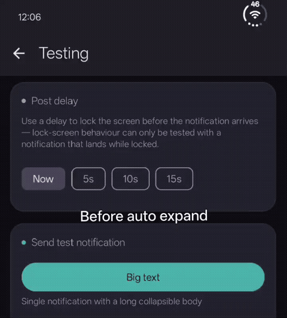
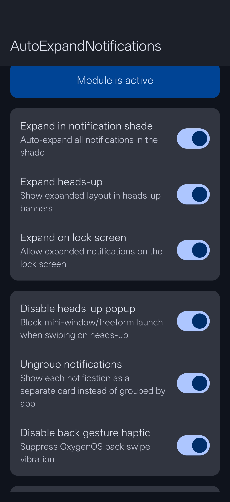

# Auto Expand

A tool that improves how notifications behave.

## Before and After

## Supported devices

| Company | System | Status |
|---|---|---|
| OnePlus / OPPO / Realme | OxygenOS / ColorOS 16 | ✅ Tested on device |
| Xiaomi / Redmi / POCO | HyperOS 3 | ✅ Verified against SystemUI |
| vivo / iQOO | OriginOS 6 | ✅ Verified against SystemUI |
| Honor | MagicOS | ✅ Verified against SystemUI |
| Google / Motorola / Sony / Nothing | AOSP / Android 16 | ◐ Engine 2 tested on emulator |
| Samsung | One UI | ⏳ Not yet |
| ASUS | ZenUI / ROG | ⏳ Not yet |

*Tested = run on the phone. Verified = checked against that company's real SystemUI files.*

## Screenshot

## What's inside

- Expands notifications in the shade and on the lock screen.
- Expanded heads-up banners, with a line limit you choose.
- Group handling and per-app exclusions.
- An engine selector (Auto / Engine 1 / Engine 2) with a short built-in test procedure.

## License

GPL-3.0 — see [LICENSE](LICENSE).

## Disclaimer

This module modifies SystemUI and Gboard through Xposed hooks. It's extensively tested, but use it at your own risk — keep a backup and have bootloop protection in place.
